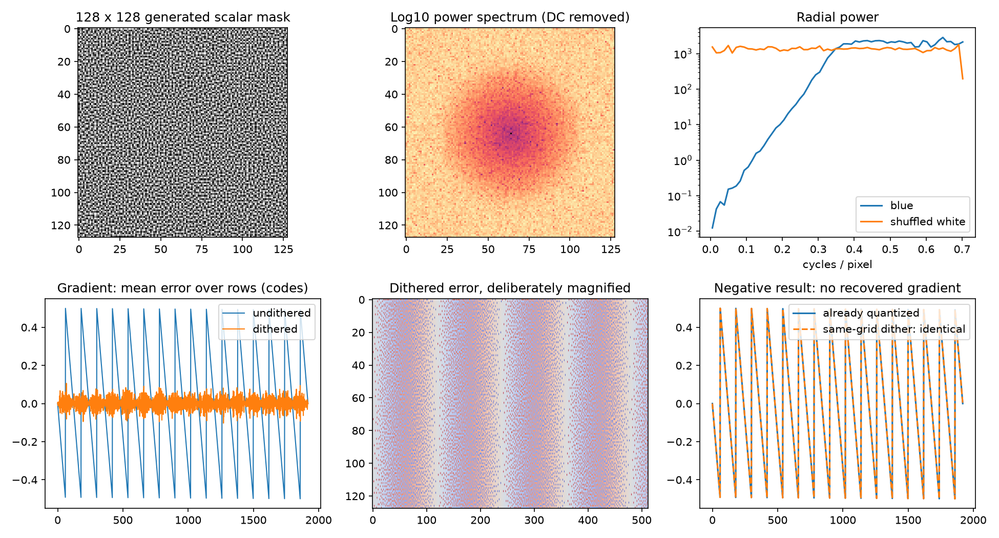

# Supplied-package validation report

The following measurements and check counts are reproduced from the supplied
Output_Dither 1.0.0 package. They are historical package evidence and were not
rerun as part of this repository integration. Current integration checks and
limitations are recorded in
[`validation/Output_Dither/INTEGRATION_VALIDATION.md`](../../validation/Output_Dither/INTEGRATION_VALIDATION.md).

Measured on 2026-11-04. This report is generated from the included JSON evidence, not estimated performance.

**416/416 analytical/reference/adapted-CPU/compiler assertions passed; 210 offscreen GPU assertions passed across 146 draws.** Check counts include variants and individual invariants; they are not independent perceptual trials.

## Evidence levels

| Level | Status and scope |
|---|---|
| Analytical reasoning | Ideal full-range nearest quantization, finite-mask mean/probability error and same-grid limitation derived |
| CPU reference | NumPy float64/float32 tests, all requested resolutions, endpoint/color/error/spectrum tables |
| Adapted production CPU | executed: exact scalar .fxh plus adapted C++ pixel wrapper; not a shader interpreter |
| ReShade FX parsing/code generation | 32 HLSL/GLSL variants; resolution overrides and resource removal verified; disclosed lexer portability change |
| Microsoft HLSL bytecode compilation | 32 entry-point compilations using d3dcompiler_47.dll; a CPU stage |
| GPU driver compilation and execution | NVIDIA GeForce RTX 4070 Ti; D3D11 hardware FL11_0, generated production bytecode, raw offscreen targets, readback |
| In-game ReShade / Signal Inspector | NOT RUN; no game or Signal Inspector source was supplied |
| DWM / HDR composition / display-link / panel | NOT RUN; offscreen tests do not verify physical HDR or monitor appearance |
| Temporal statistics | Not applicable; only static spatial noise is implemented |

The host reported NVIDIA driver version **32.0.16.2101**. This is one hardware/driver/API configuration. Other APIs and driver versions may differ. No GPU timing or FPS was measured.

## Ideal quantization: useful result and deliberate negative result

1920×1080 encoded ramp spanning codes 32…48; span=1.0. Error statistics are in target code steps. Both 8-bit and 10-bit results match to displayed precision.

| Metric | Without dither | With dither |
|---|---:|---:|
| Total error RMS | 0.2886 | 0.408173 |
| RMS of column-mean error | 0.2886 | 0.0300578 |
| Error-energy fraction below 0.1 cycles/pixel | 0.948748 | 0.00117153 |
| Mean error | 1.91425e-15 | 0.000406539 |

Dither increases total RMS error while reducing its spatially structured low-frequency component. Column-mean error is one banding proxy, not a universal visibility metric.

Already-quantized ramps passed through the **same ideal quantizer changed 0 pixels**, for both code grids. Exhaustive tests also cover every code, every mask byte and spans 0.25/0.5/1.0. Doubling the span in a CPU-only test changed 49.995% of codes and increased RMS error to 0.763714. Production rejects this strength. No lost detail was recovered.

## Actual GPU writes: important negative finding

At 1920×1080, full-range same-grid ramps gave:

| Raw input/output | Contract | Changed RGB fraction | Mean code change |
|---|---|---:|---:|
| RGBA8 UNORM | sRGB | 3.1167% | -0.0311666 |
| RGB10A2 UNORM | sRGB | 3.1208% | -0.0312076 |
| RGB10A2 UNORM | PQ | 3.1208% | -0.0312076 |

The changes were down by one code, not reconstruction of fractional input. The initial ideal-equality expectation was rejected by the GPU measurement. D3D11 permits 0.6-code FLOAT→UNORM conversion tolerance. No exact vendor rounding algorithm is inferred, and no compensating bias is applied. **Do not enable this effect on same-grid input on the strength of a visual noise change.**

Constant near-black fields expose the difference from the ideal unbiased expectation:

| Assumption | Input (codes) | Actual GPU mean error (codes) | Mismatch with ideal CPU codes |
|---|---:|---:|---:|
| 256 levels / sRGB | 0.05 | -0.05 | 5.083% |
| 256 levels / sRGB | 0.25 | -0.0585937 | 5.853% |
| 256 levels / sRGB | 0.5 | -0.0586155 | 5.859% |
| 256 levels / sRGB | 12.25 | -0.0117911 | 1.173% |
| 1024 levels / sRGB | 0.05 | -0.05 | 5.083% |
| 1024 levels / sRGB | 0.25 | -0.0625 | 6.243% |
| 1024 levels / sRGB | 0.5 | -0.0625289 | 6.250% |
| 1024 levels / sRGB | 12.25 | -0.0508172 | 5.075% |
| 1024 levels / PQ | 0.05 | -0.05 | 5.083% |
| 1024 levels / PQ | 0.25 | -0.0625 | 6.243% |
| 1024 levels / PQ | 0.5 | -0.0625289 | 6.250% |
| 1024 levels / PQ | 12.25 | -0.0508172 | 5.075% |

The hardware sanity assertions bound error; they do **not** establish the ideal 1/512-code bias bound on GPU. For example the 0.05-code field produced no upward code coverage in these GPU tests. Near-black dithering effectiveness is limited here.

## Controlled higher-precision GPU cases

These separate cases establish that the implementation can meaningfully distribute error when fractional information exists. They do not prove that an ordinary ReShade COLOR buffer has that information.

| Path | Column-mean RMS without | Column-mean RMS with | Total RMS with |
|---|---:|---:|---:|
| FP32 to actual UNORM8 | 0.290818 | 0.0466288 | 0.409996 |
| FP32 to actual UNORM10 sRGB | 0.289586 | 0.0383228 | 0.408861 |
| FP32 to actual UNORM10 PQ | 0.289586 | 0.0383228 | 0.408861 |
| encoded FP16 to FP16 then ideal 8-bit | 0.288765 | 0.0358353 | 0.407652 |
| encoded FP16 to FP16 then ideal 10-bit | 0.288734 | 0.0392482 | 0.408432 |
| sRGB UNORM10 to UNORM10 then ideal 8-bit | 0.28903 | 0.0816387 | 0.42146 |

All values are target code steps. “Then ideal” explicitly means a CPU downstream quantizer after GPU readback; the final physical conversion is unverified. FP32→UNORM tests are also evidence for dithering integrated inside a preceding high-precision effect, not a claim that standalone ReShade normally changes the target format.

On FP32 input/output, maximum absolute GPU-versus-CPU sample difference across the resolution/contract matrix was **5.96046e-08**. Tested FP32 and FP16 bypass bits, signed/extended values, NaN/infinities, alpha, and exact UNORM pass-through at zero strength/master bypass were preserved. This is not a universal NaN-payload or denormal guarantee.

## Asset, tiling and spectrum

128×128 R8, one mip. Exactly 64 samples per byte value. Centered mean 0; extrema -0.498047…0.498047; RMS 0.288673. At span 1 these are target-code units before clipping.

| Signal | Fraction of spectral energy below 0.1 cycles/pixel |
|---|---:|
| scalar | 5.36027e-06 |
| threshold_10 | 0.00139018 |
| threshold_50 | 0.00055749 |
| threshold_90 | 0.00150711 |
| white_scalar | 0.0322908 |

DC is removed; frequency radius is Euclidean. The white control is a shuffled identical histogram. Threshold tests examine approximately 10%, 50% and 90% occupancy. The low-frequency hole supports the blue-noise classification; it is not a claim of perfect isotropy or invisible repetition.

| Axis | Internal neighbor-difference RMS | Wrap seam RMS |
|---|---:|---:|
| 0 | 0.460768 | 0.464369 |
| 1 | 0.462242 | 0.462292 |

No discontinuity is introduced by a nonperiodic generator. The mask still repeats every 128 pixels. Cropped images do not inherit exact tile mean:

| Resolution | Tiles across × down | Cropped noise mean |
|---|---:|---:|
| 1920×1080 | 15 × 8.4375 | -1.19527e-05 |
| 1920×1200 | 15 × 9.375 | 3.30607e-06 |
| 2560×1440 | 20 × 11.25 | 2.9246e-06 |
| 3440×1440 | 26.875 × 11.25 | 1.81134e-06 |
| 1919×1079 | 14.9922 × 8.42969 | 8.84122e-06 |
| 1×137 | 0.0078125 × 1.07031 | -0.0314068 |
| 137×1 | 1.07031 × 0.0078125 | -0.00651517 |
| 1×1 | 0.0078125 × 0.0078125 | -0.337891 |

All dimensions were used in CPU, FX generation and GPU rendering, not just filenames. A parser fixture independently verifies BUFFER_WIDTH/HEIGHT. Singleton sizes are synthetic indexing stress tests; ordinary ReShade rejects very small swap chains.

## Endpoint and color checks

Exact black, white and saturated endpoint primaries remain exact. Per-channel endpoint locking allows other channels to change on partially saturated colors. At x=0.1/L, explicit clipping shifts the prequantizer tile mean upward by 0.07999878 code; ideal finite-mask quantized mean error is +0.0015625 code. No claim of unbiased clipped prequantizer noise is made. Full CPU tables include near-white counterparts and finite probability limitations.

Correlated and spatially shifted channel noise were compared on neutral, colored, saturated, near-black and near-white patches in sRGB and PQ. Correlated noise retained exact neutrality under the tested ideal common grid; shifted channels gave 0.70425-code opponent RMS on neutral 0.5 sRGB. A colored [0.123,0.457,0.789] patch still had chromatic changes in correlated mode. Linear luminance changed too. Per-channel means, RMS, opponent differences and linear luminance shifts are included in results.json; hue/saturation preservation is not asserted.

Incorrect linear-domain examples are intentionally extreme for PQ: the fixture adds a uniform 1/1023 step to linear values normalized to 10,000 nits, then encodes. This is not a proposed scRGB algorithm. At encoded PQ 0.5 its perturbation RMS is about 3.125 target codes, versus 0.288673 for encoded-domain dither. At encoded sRGB 0.05 with an 8-bit target it is about 3.249 codes. The distribution varies with brightness; a fixed linear step is not a fixed encoded step.

## Resource and feature checks

Production has one pass, two samplers, COLOR plus a 128×128 R8 asset, and no other render target. Compile-time disable removes the noise texture, its sampler, helpers and uniforms. A disabled isolated build succeeds without the include/asset; an active missing-include build correctly fails. All contract/target pairs, invalid enum values and strength bounds were exercised by CPU tests. Runtime missing-PNG behavior was source-inspected, not launched in ReShade; install the asset and resolve load errors.

## Conclusion

This standalone shader can reduce structured quantization error for a verified encoded signal that retains finer information than a known later quantizer. Controlled tests include encoded FP16 and 10-bit sRGB preceding coarser quantization. It offers no recovery of an already-quantized same-grid gradient and can add biased code perturbations on real UNORM writes. Unknown downstream conversion and physical display behavior remain unverified; scRGB is deliberately bypassed. When the preceding effect first discards the useful fractional signal, integrate dithering into that effect before its lossy write. Default bypass is intentional.
